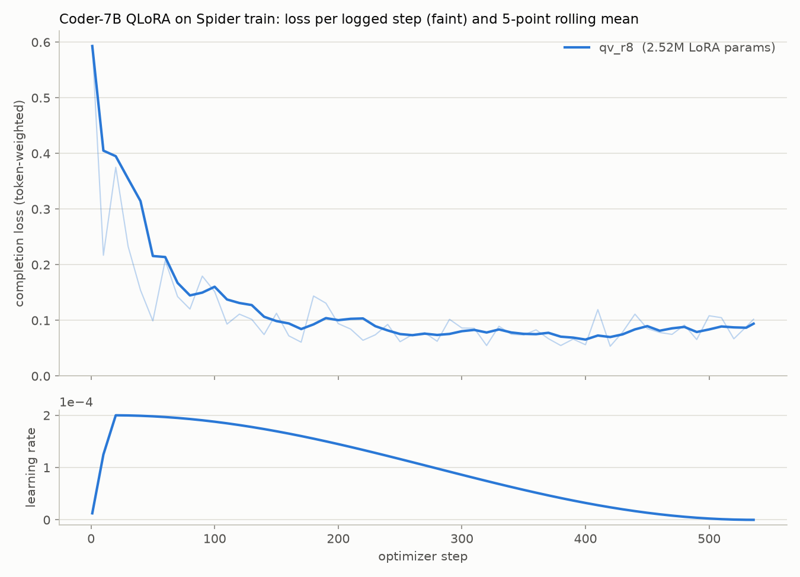
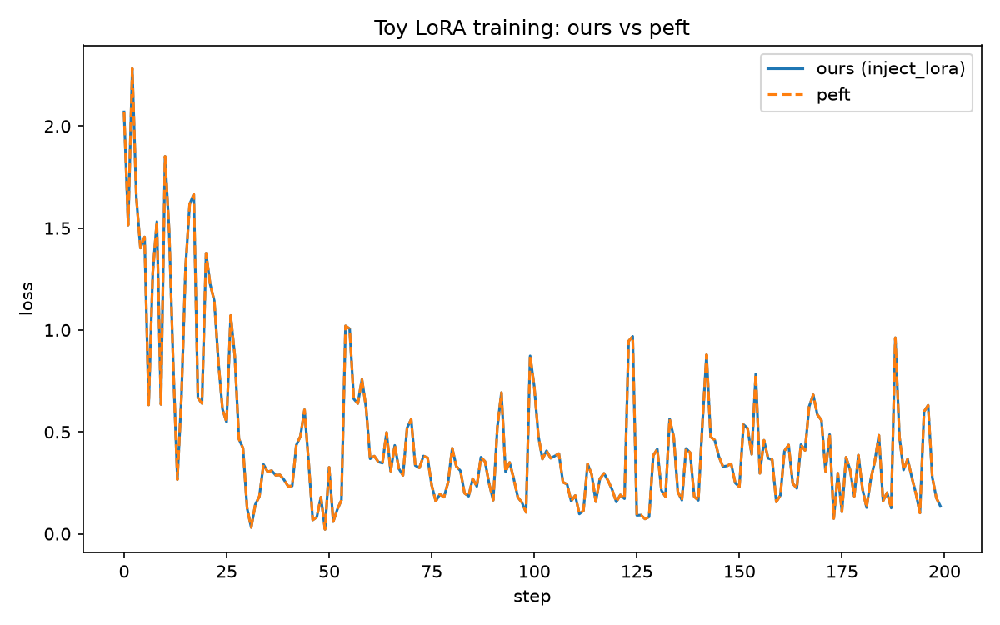

# MinLoRA-SQL

A from-scratch implementation of LoRA and QLoRA, verified bit-for-bit against Hugging Face `peft`,
used to fine-tune Qwen2.5-Coder-7B-Instruct for text-to-SQL on a single 8 GB laptop GPU and
evaluated by execution accuracy on Spider.

## Summary

- **Numerical parity with `peft`.** The LoRA layer, injection and training path are written from
  scratch and match `peft` 0.19.1 exactly. Forward outputs and gradients are bit-identical in fp32,
  bit-identical on the 4-bit QLoRA path (including a non-power-of-two scaling case that exposes
  cast-order bugs), and a 200-step training run matches step for step.
- **QLoRA on consumer hardware.** A custom training loop fine-tunes a 7.6B-parameter model on an
  RTX 4060 Laptop GPU (8 GB). Five adapter configurations, varying rank and target modules, train
  in 2.3 to 3.1 hours each with peak memory at or below 6.74 GB.
- **Execution-based evaluation.** Generated SQL is run against the Spider databases and its result
  rows are compared with the gold query's. The harness is read-only, time-limited and NULL-safe. It
  refuses held-out data and records the exact checkpoint and commit behind every number.
- **Result.** Fine-tuning raises Spider dev execution accuracy from 74.95% (base) to 77.56% (best
  configuration). Paired significance testing shows that the gain is real in the data but not
  conclusive after correcting for multiple comparisons, and there is evidence that the base model
  has already seen Spider during pretraining.

## Results

### Spider dev execution accuracy

All six models answer the same 1,034 dev questions with greedy decoding.

| Model | Target modules | Rank | LoRA params | Dev EX (%) | Δ vs base | Won / lost vs base | McNemar p (Holm) |
|---|---|---|---|---|---|---|---|
| Base (no adapter) | none | | 0 | 74.95 | | | |
| `qv_r4` | q, v | 4 | 1.26M | 75.92 | +0.97 | +76 / −66 | 0.450 (0.900) |
| `qv_r8` | q, v | 8 | 2.52M | 75.92 | +0.97 | +77 / −67 | 0.453 (0.900) |
| `qv_r16` | q, v | 16 | 5.05M | 77.47 | +2.51 | +85 / −59 | 0.037 (0.164) |
| `attn_r8` | q, k, v, o | 8 | 5.05M | 76.79 | +1.84 | +74 / −55 | 0.113 (0.338) |
| `all7_r8` | q, k, v, o, gate, up, down | 8 | 20.19M | 77.56 | +2.61 | +88 / −61 | 0.033 (0.164) |

"Won / lost" counts the questions a fine-tuned model answers correctly that the base model does
not, and the reverse. p-values are exact two-sided McNemar tests on those discordant pairs, with
Holm-adjusted values in parentheses for the five comparisons against the base. Bootstrap confidence
intervals, pairwise comparisons between configurations and a column-order robustness check are in
[`results/eval/summary.md`](results/eval/summary.md), which is generated from the committed
per-question results by `scripts/summarize_eval.py`.

### Accuracy by difficulty

Spider assigns each question one of four official difficulty tiers by counting the SQL components
of its gold query. Here the tiers come from the official `eval_hardness` function, vendored from
[taoyds/spider](https://github.com/taoyds/spider). Cells show dev EX (%) with the change against
the base model in parentheses.

| Model | Easy (248) | Medium (446) | Hard (174) | Extra (166) | All (1,034) |
|---|---|---|---|---|---|
| Base (no adapter) | 90.32 | 75.34 | 70.11 | 56.02 | 74.95 |
| `qv_r4` | 89.52 (−0.81) | 78.70 (+3.36) | 69.54 (−0.57) | 54.82 (−1.20) | 75.92 (+0.97) |
| `qv_r8` | 89.92 (−0.40) | 78.25 (+2.91) | 68.97 (−1.15) | 56.02 (+0.00) | 75.92 (+0.97) |
| `qv_r16` | 90.32 (+0.00) | 79.82 (+4.48) | 72.41 (+2.30) | 57.23 (+1.20) | 77.47 (+2.51) |
| `attn_r8` | 90.73 (+0.40) | 77.58 (+2.24) | 72.41 (+2.30) | 58.43 (+2.41) | 76.79 (+1.84) |
| `all7_r8` | 91.13 (+0.81) | 79.37 (+4.04) | 72.99 (+2.87) | 57.23 (+1.20) | 77.56 (+2.61) |

In the smallest tier one question is worth 0.6 points, so the per-tier differences are descriptive
and are not tested for significance. Per-tier won / lost counts are in
[`results/eval/summary.md`](results/eval/summary.md).

### Findings

- **Every configuration improves on the base, but modestly.** The two best configurations gain
  about 2.5 points, with nominal p ≈ 0.035. No gain survives Holm correction at the 0.05 level.
- **Fine-tuning reshuffles answers more than it adds them.** Each model fixes 74 to 88 questions
  the base got wrong and breaks 55 to 67 it got right.
- **The gain sits mostly in medium questions.** Counting questions won minus lost against the
  base, every configuration gains 10 to 20 on medium and between −5 and +9 on the other three tiers
  combined. For `qv_r4` and `qv_r8` the whole gain is on medium. Extra-hard questions change the
  most (23–27% flip in one direction or the other) but show almost no net gain. Easy questions are
  near the ceiling already (90.3% for the base).
- **Rank.** On the query and value projections, rank 4 and rank 8 are tied (785 correct each).
  Rank 16 outperforms rank 8 on 24 questions against 8 (unadjusted p = 0.007).
- **Target modules.** Adapting all seven projections gives the lowest training loss by a wide
  margin (0.065 against roughly 0.085), but its accuracy ties `qv_r16`, which has a quarter of the
  parameters (40 questions won, 39 lost).
- **What changes.** Gains come from adopting Spider's conventions: `INTERSECT` for "both X and Y",
  exact equality instead of `LIKE` patterns, literals copied as written, and fewer unnecessary
  joins. Losses come mainly from column names invented in Spider's snake_case style that do not
  exist in the schema, and occasionally from a dropped `DISTINCT`.
- **Likely contamination.** Without any fine-tuning, the base model reproduces formatting quirks
  of Spider's gold queries (for example `Country ,  COUNT(*)` with a doubled space). That suggests
  Spider was in its pretraining data, which limits the headroom fine-tuning can show.

### Training

| Run | Steps | Train time | Peak reserved memory | Final loss (mean of last 10 logged) |
|---|---|---|---|---|
| `qv_r4` | 536 | 2.27 h | 6.21 GB | 0.090 |
| `qv_r8` | 536 | 2.29 h | 6.23 GB | 0.087 |
| `qv_r16` | 536 | 2.25 h | 6.26 GB | 0.084 |
| `attn_r8` | 536 | 2.31 h | 6.27 GB | 0.080 |
| `all7_r8` | 536 | 3.06 h | 6.74 GB | 0.065 |



All runs see the same examples in the same order, so their loss spikes occur at the same steps.
Per-run logs, data reports and adapter metadata are in [`results/train/`](results/train/).

## Verification against `peft`

The central engineering claim is that the from-scratch implementation computes exactly what `peft`
computes. The test suite checks this directly rather than by comparing loss curves by eye.

| Check | Setting | Result |
|---|---|---|
| Forward and backward parity | Qwen2.5-0.5B-Instruct, fp32, ranks 4, 8 and 16, and all seven target modules | max abs difference 0.0 in logits and in every `lora_A` and `lora_B` gradient (tolerance 1e-6) |
| QLoRA-path parity | 0.5B base in 4-bit NF4 with bf16 compute and fp32 adapters, including scaling 1.5 | max abs difference 0.0 in logits and gradients |
| Training trajectory | 200 optimizer steps, identical initialisation, data and seed | max per-step loss difference 0.000000 |

Two details make these tests meaningful:

- **Randomised `lora_B`.** LoRA initialises `B` to zero, so a freshly initialised adapter is a
  no-op in both implementations, and a naive parity test compares the base model with itself.
  The tests randomise `peft`'s `B`, transplant the weights, and only then compare.
- **Non-power-of-two scaling.** Every training configuration uses alpha = 2r, a scaling of 2.0.
  Multiplication by 2.0 is exact in every floating-point format, so it hides errors in the order
  of dtype casts. A scaling of 1.5 exposed such an error during development (a logit difference of
  0.32), which was fixed by mirroring `peft`'s cast order exactly.



## Method

**Models.** Qwen2.5-Coder-7B-Instruct is the fine-tuning target. Qwen2.5-0.5B-Instruct shares its
module names and serves only as an fp32 test fixture for the parity suite; it is never fine-tuned.

**Data.** Training uses Spider `train_spider.json` and `train_others.json` (8,659 examples).
Evaluation uses `dev.json` (1,034 examples over 20 databases not seen in training). The Spider
test split is never read. Examples longer than 2,048 tokens are dropped, which removes exactly the
82 examples of one database (`baseball_1`) and leaves 8,577.

**Prompt.** Each database schema is rendered as `CREATE TABLE` statements with column types,
primary keys and foreign keys, followed by the question. A single function builds the ChatML token
ids for both training and evaluation, so the model is evaluated on exactly the format it was
trained on.

**Training.**
- Base: 4-bit NF4 with double quantisation, bf16 compute, gradient checkpointing.
- Adapters: kept in fp32 so that small AdamW updates are not rounded away. Base parameters are
  never upcast, and `torch.autocast` is not used.
- Batching: micro-batch 1 with 16-step gradient accumulation, weighted by token count so that the
  update equals that of a true batch of 16.
- Loss: computed on the SQL completion only, with the vocabulary projection evaluated only for
  completion positions.
- Optimiser: AdamW, learning rate 2e-4, 3% linear warmup and cosine decay, gradient clipping at
  1.0, LoRA dropout 0.05.
- Schedule: one epoch, 536 optimizer steps. All five configurations share the data settings and
  data order (a test enforces this) and differ only in their LoRA settings.

**Checkpoints.** Only adapter weights are saved (safetensors), with a JSON sidecar describing the
adapter and its provenance. Loading rebuilds the adapter from the sidecar and then asserts that
every saved tensor was consumed and matches exactly, and that the adapter is not a no-op. A
`load_state_dict(strict=False)` that silently loads nothing would otherwise evaluate the base model
under a fine-tuned label.

**Evaluation.**
- Decoding: greedy, with up to 256 new tokens.
- Execution: each prediction runs on a read-only connection to its Spider database with a 30-second
  limit. Every gold query is executed before the model loads.
- Comparison: results are compared as multisets of rows, which is NULL-safe and duplicate-sensitive,
  with floats rounded to six places. Row order is compared only when the gold query contains
  `ORDER BY`.
- Columns are compared by position. That is stricter than the official test-suite evaluation, which
  allows any column order. Rescoring with column permutations allowed raises every model by 2.3 to
  3.2 points and the base model the most, so it does not change the conclusions.

## Repository layout

```
src/lora_sql/
  lora.py          LoRALinear, inject_lora, parameter statistics
  qlora.py         4-bit model loading, training preparation, dtype assertions, completion loss
  data.py          Spider loading, schema rendering, the single prompt-encoding function
  config.py        strict typed training configuration
  checkpoint.py    save_lora / load_lora with load-time verification
  train.py         the training loop
  eval/            runner.py (generation), execute.py (SQLite execution and comparison),
                   metrics.py (aggregation, Spider difficulty tiers)
configs/
  train/           qv_r4, qv_r8, qv_r16, attn_r8, all7_r8
  eval/            coder7b_spider_dev.yaml
  week1_parity.yaml  smoke-test evaluation on the 0.5B model
scripts/           environment checks, toy parity run, memory probe, training and evaluation
                   chains, plotting, results summary
tests/             95 tests: injection, fp32 and 4-bit parity, data, configuration, loss,
                   checkpointing, training loop, evaluation, difficulty tiers
results/           committed evidence: figures, memory probes, training logs, per-question
                   evaluation results, summary table
docs/              an explanatory guide to the project, from background to results
```

## Reproducing

**Requirements.** Linux, an NVIDIA GPU with at least 8 GB of memory and bf16 support, CUDA 12.1
drivers, Python 3.11, and about 20 GB of disk for the model weights and data.

```bash
python3.11 -m venv .venv
source .venv/bin/activate
pip install -r requirements.txt          # pinned versions, installs lora_sql in editable mode
python scripts/check_env.py              # CUDA, bitsandbytes, model loading, target modules
```

Download Spider from the [official site](https://yale-lily.github.io/spider) and extract it so that
`data/spider_data/` contains `train_spider.json`, `train_others.json`, `dev.json`, `tables.json` and
`database/`. The Qwen models are downloaded from the Hugging Face Hub on first use.

```bash
# Tests (the parity and runner tests need the GPU and the 0.5B model)
pytest -v

# Train one configuration, or several back to back -> runs/<name>/
python -m lora_sql.train --config configs/train/qv_r8.yaml
bash scripts/train_chain.sh qv_r4 qv_r16 attn_r8 all7_r8

# Evaluate the base model and each adapter on Spider dev -> results/eval/<name>.json
bash scripts/eval_chain.sh base qv_r8 qv_r4 qv_r16 attn_r8 all7_r8

# Figures and the results table
python scripts/plot_train.py --runs qv_r8 qv_r4 qv_r16 attn_r8 all7_r8
python scripts/summarize_eval.py
```

On an RTX 4060 Laptop GPU, each training run takes 2.3 to 3.1 hours and each full dev evaluation
takes 20 to 28 minutes.

## Limitations

- **Single seed.** Each configuration was trained once, so differences between configurations
  include unmeasured seed-to-seed variance.
- **Probable contamination.** Spider is public and widely used. The base model's behaviour suggests
  it was in the pretraining data, which inflates the baseline and compresses fine-tuning gains.
- **Execution accuracy on a single database instance.** The official test-suite metric executes
  queries on several database variants to reduce false positives; this harness uses the released
  databases only. Results are therefore not directly comparable with published test-suite numbers.
- **One database excluded from training.** The 82 `baseball_1` examples exceed the 2,048-token
  limit that the largest configuration fits in memory.

## License

The code in this repository is released under the [MIT License](LICENSE), except for the Spider
difficulty function (`eval_hardness` and its helpers) in `src/lora_sql/eval/metrics.py`. That code
is vendored from [taoyds/spider](https://github.com/taoyds/spider) under the Apache License 2.0;
its license is in [`licenses/spider-LICENSE`](licenses/spider-LICENSE).

The Spider dataset (CC BY-SA 4.0) and the Qwen2.5 model weights (Apache 2.0) are not redistributed
here and are subject to their own licenses.

## References

- Hu et al., *LoRA: Low-Rank Adaptation of Large Language Models*, 2021.
- Dettmers et al., *QLoRA: Efficient Finetuning of Quantized LLMs*, 2023.
- Yu et al., *Spider: A Large-Scale Human-Labeled Dataset for Complex and Cross-Domain Semantic
  Parsing and Text-to-SQL Task*, 2018.
- Zhong et al., *Semantic Evaluation for Text-to-SQL with Distilled Test Suites*, 2020.
- Hui et al., *Qwen2.5-Coder Technical Report*, 2024.
- Hugging Face [`peft`](https://github.com/huggingface/peft) and
  [`bitsandbytes`](https://github.com/bitsandbytes-foundation/bitsandbytes).
