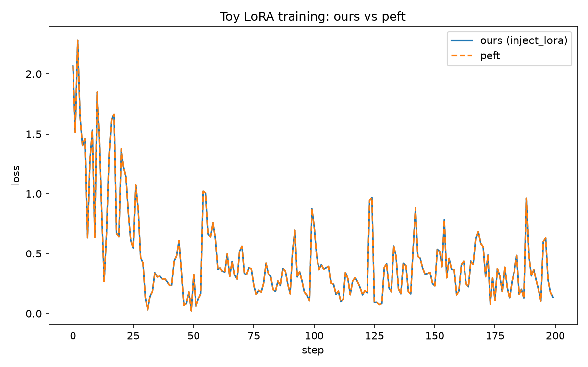
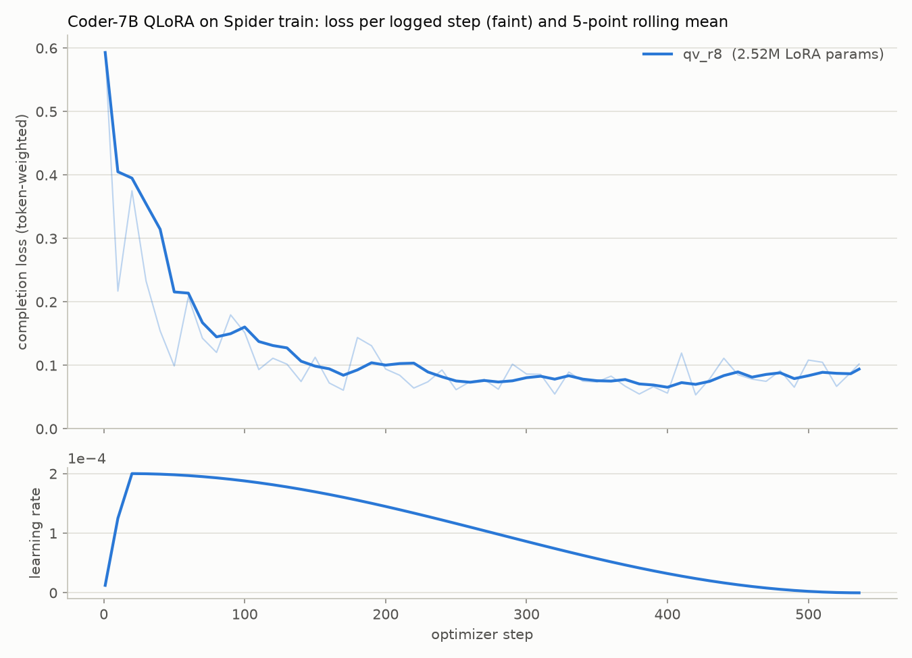
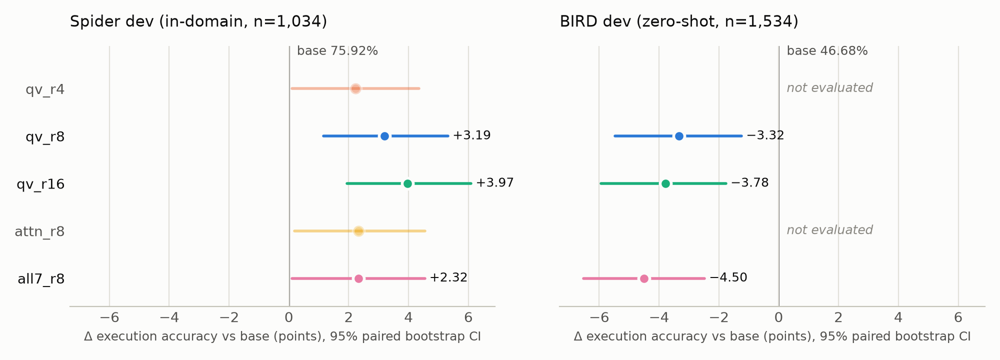
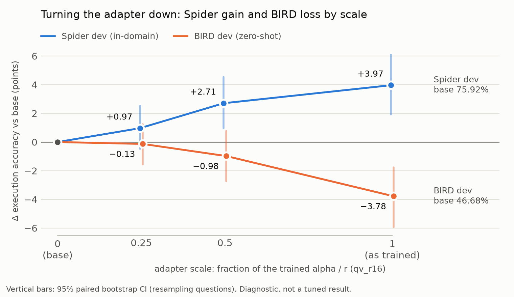
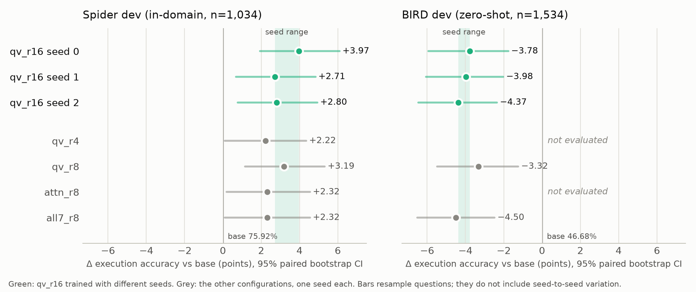

# MinLoRA-SQL: a peft-exact LoRA/QLoRA implementation, and a Spider fine-tune that does not transfer to BIRD

## Abstract

I implemented LoRA and its 4-bit QLoRA variant from scratch and tested them against Hugging Face
`peft` 0.19.1. In fp32 the forward logits and the adapter gradients match `peft` with a maximum
absolute difference of 0.0; on the 4-bit path they are bit-identical (asserted with
`torch.equal`), including at a non-power-of-two scaling that exposes cast-order bugs; and a
200-step training run matches `peft`'s loss at every step. With this implementation I fine-tuned
Qwen2.5-Coder-7B-Instruct for text-to-SQL on one 8 GB laptop GPU (five adapter configurations,
2.3–3.1 h each, peak memory ≤ 6.74 GB) and scored every model by executing its SQL. On Spider dev
the adapters gain 2.2 to 4.0 points over the untuned model (75.92% → 79.88% for the best run), and
two of the five gains stay significant after correcting for multiple comparisons. On BIRD dev,
which the adapters never saw, the three adapters tested lose 3.3 to 4.5 points (46.68% →
42.18–43.35%, Holm-adjusted p ≤ 0.002). Counting the predictions shows why: the adapters learned
Spider's conventions, and on BIRD those conventions are wrong. Three follow-ups qualify this.
Trained with two more seeds, the best configuration is above the base on Spider and below it on
BIRD every time, but the reported run is the highest of the three and the five runs do not rank
the configurations (Section 7.7). Run at half its trained strength with no retraining, that
adapter keeps 68% of its Spider gain and shows 26% of its BIRD loss (Section 7.6). And a first
round of these evaluations silently inherited a repetition penalty of 1.1 from the model's
generation config; removing it changed 40–66% of the predictions and one of the conclusions
(Section 7.5).

## 1. Introduction

Most LoRA projects use `peft` and report a loss curve. This one asks two narrower questions and
tries to answer each with evidence that does not depend on judgment:

1. Can a from-scratch LoRA be shown to compute exactly what `peft` computes? The bar is identical
   numbers on both the fp32 and the 4-bit path, which two similar-looking loss curves cannot show.
2. Does fine-tuning make the model better at writing SQL? I measure this by running each generated
   query against the real database and comparing result rows, with paired significance tests, on
   the training benchmark and on a second benchmark the model was not trained on.

The contributions are:

- A LoRA/QLoRA implementation (`src/lora_sql/lora.py`, `qlora.py`) with a parity suite that
  compares it with `peft` exactly, and a description of the two test design choices without which
  such a suite passes vacuously (Section 4).
- A training loop that fine-tunes a 7.6B-parameter model in 4-bit on 8 GB, and a hardened
  execution-accuracy harness (read-only, time-limited, NULL-safe, held-out guard, provenance on
  every result) for Spider and BIRD (Sections 5–6).
- A rank and target-module ablation on Spider, with paired tests (Section 7.1–7.2).
- A measured negative transfer result: Spider fine-tuning lowers BIRD accuracy by 3.3 to 4.5
  points, with counted evidence of the mechanism (Sections 7.3–7.4).
- A decoding ablation: the repetition penalty that `generate()` inherits from Qwen's generation
  config, measured on all nine evaluations (Section 7.5).
- A scaling probe: the best adapter run at a half and a quarter of its trained strength on both
  benchmarks, to see how the gain and the loss trade off (Section 7.6).
- Seed repeats of the best configuration, scored on both benchmarks, to set the gain, the loss
  and the gaps between configurations beside seed-to-seed variation (Section 7.7).

## 2. Background

**LoRA** (Hu et al., 2021) freezes a pretrained weight matrix `W` (shape `out × in`) and learns a
low-rank update: the layer computes `W x + (alpha / r) · B A x`, where `A` is `r × in`, `B` is
`out × r`, and `r` is much smaller than `in` and `out`. `B` starts at zero, so training starts from
the unmodified model. Only `A` and `B` are trained.

**QLoRA** (Dettmers et al., 2023) stores the frozen base in 4-bit NormalFloat (NF4), computes in
bf16, and keeps the LoRA matrices in higher precision. This is what makes a 7B model trainable on
an 8 GB GPU.

**Text-to-SQL** maps a question and a database schema to a SQL query. **Spider** (Yu et al., 2018)
is the standard cross-database benchmark: its dev set has 1,034 questions over 20 databases that do
not appear in training. **BIRD** (Li et al., 2023) is newer and harder: 1,534 dev questions over 11
larger, messier databases, each question paired with an expert hint ("evidence"). Both are scored
by **execution accuracy (EX)**: a prediction is correct if it returns the same rows as the gold
query. Spider's official metric executes on several database variants to cut false positives
(Zhong et al., 2020); this project executes on the released databases only (see Limitations).

## 3. Models and hardware

- The fine-tuning target is Qwen2.5-Coder-7B-Instruct (Hui et al., 2024), 28 layers, hidden size
  3,584, grouped-query attention with 28 query and 4 key/value heads.
- The parity fixture is Qwen2.5-0.5B-Instruct. It has the same module names as the 7B
  (`q_proj`, `k_proj`, `v_proj`, `o_proj`, `gate_proj`, `up_proj`, `down_proj`), so target-module
  strings carry over unchanged, and it is small enough to run in fp32. It is never fine-tuned.
- The hardware is one RTX 4060 Laptop GPU with 8.2 GB of memory. Software: torch 2.5.1, transformers
  5.14.1, peft 0.19.1 (reference only), bitsandbytes 0.49.2.

## 4. Implementation and parity verification

### 4.1 The layer

`LoRALinear` wraps an existing linear layer (a plain `nn.Linear` or a bitsandbytes `Linear4bit`),
freezes it, and adds `A` and `B` in fp32. `inject_lora` replaces the named target modules
throughout the model and freezes everything else. Two details matter on the 4-bit path:

- Layer dimensions come from `in_features` / `out_features`, never from the weight's shape.
  Under `Linear4bit` the stored weight is packed and its shape is wrong.
- The order of dtype casts mirrors `peft`'s `Linear4bit.forward` exactly. The input is cast to
  the adapter dtype (fp32) before dropout; `B(A(dropout(x))) · scaling` is computed in fp32; the
  result is cast to the base output dtype (bf16) and then added. The base parameters are never
  upcast and `torch.autocast` is not used.

### 4.2 How the parity tests avoid passing vacuously

Two design choices turned out to be necessary.

**Randomise `B` before comparing.** Both implementations initialise `B` to zero, so a freshly
built adapter is a no-op and both models output exactly the base model's logits. A parity test
that compares them at initialisation compares the base model with itself and passes for almost any
bug; with `B = 0` the gradient of `A` is also zero. The tests randomise `peft`'s `B`, copy both
matrices into the from-scratch layers, and only then compare.

**Test a scaling that is not a power of two.** Every training configuration uses `alpha = 2r`, a
scaling of 2.0. Multiplying by 2.0 is exact in every floating-point format, so it commutes with
dtype casts and hides errors in cast order. With `alpha = 12, r = 8` (scaling 1.5) an earlier
version of the layer, which applied the scaling after the downcast, differed from `peft` by 0.32
in the logits, while still passing every scaling-2.0 test. The 4-bit suite keeps a scaling-1.5
case permanently for this reason.

**Run parity in fp32.** bf16 carries about three significant decimal digits, so two correct
implementations that sum in a different order can disagree at the 1e-2 level, and a tolerance of
1e-6 is unreachable. The fp32 suite therefore runs on the 0.5B model in fp32 (about 2 GB); the
4-bit suite runs the 0.5B in NF4 with bf16 compute, as in training.

### 4.3 Results

| Check | Setting | Result |
|---|---|---|
| Forward and backward | 0.5B, fp32; r = 4, 8, 16 on q/v, and r = 8 on all seven modules | max abs difference 0.0 in logits and in every `lora_A` / `lora_B` gradient (asserted at atol 1e-6) |
| 4-bit (QLoRA path) | 0.5B in NF4, bf16 compute, fp32 adapters; r = 8 on q/v at scaling 2.0 and 1.5, and on all seven modules | bit-identical logits and gradients (`torch.equal`) |
| Training trajectory | 0.5B, r = 8 on q/v, 200 optimizer steps, lr 2e-4, same init, data and seed | max per-step loss difference 0.000000 |

Sources: `tests/test_lora_parity.py`, `tests/test_lora_4bit.py`, `results/toy_loss_*.json`.



*Figure 1. 200-step LoRA training on Qwen2.5-0.5B, from-scratch vs `peft`, identical
initialisation, data and seed: the maximum per-step loss difference is 0.000000. The loss falls
from 2.07 to 0.14 and the two curves coincide at every step.*

### 4.4 Checkpoints

The most dangerous failure in this kind of pipeline is silent: `load_state_dict(strict=False)`
with mismatched key names loads nothing, raises nothing, and the "fine-tuned" evaluation is really
the base model. Adapters are therefore saved as `lora_` keys only, with a JSON sidecar that records
the targets, rank, alpha and dtype read from the modules themselves, plus the config hash and git
commit. Loading rebuilds the adapter from the sidecar and asserts that there are no unexpected
keys, that every saved tensor was consumed and is `torch.equal` to the file, and that at least one
`B` is nonzero.

## 5. Training setup

**Data.** Spider `train_spider.json` and `train_others.json`, 8,659 examples. Spider dev is used
only for evaluation and the Spider test split is never read. A memory probe on the largest
configuration (`results/probe_all7_r8.json`) fits sequences of 2,048 tokens but not 2,560; at 2,048
exactly the 82 examples of one database (`baseball_1`) are dropped, leaving 8,577
(`results/train/*/data_report.json`).

**Prompt.** The schema is rendered as `CREATE TABLE` statements with column types, primary keys
and foreign keys, followed by the question. One function builds the ChatML token ids (with a fixed
system prompt) for both training and evaluation, so evaluation uses exactly the training format.

**Objective.** Loss on the SQL completion only (the vocabulary projection is computed only at
completion positions), micro-batch 1 with 16-step gradient accumulation, weighted by token count
so each update equals that of a true batch of 16.

**Hyperparameters** (shared by all runs): AdamW, learning rate 2e-4, 3% linear warmup then cosine
decay to 0, weight decay 0, gradient clipping 1.0, LoRA dropout 0.05, `alpha = 2r`, one epoch =
536 optimizer steps, seed 0. NF4 with double quantisation, bf16 compute, gradient checkpointing.
All five configurations use identical data settings and data order (a test enforces this) and
differ only in LoRA rank and targets. Section 7.7 adds two further runs of `qv_r16` that differ
from it only in the seed (1 and 2).

| Run | Targets | Rank | LoRA params | Train time | Peak reserved memory | Loss (mean of last 10 logged) |
|---|---|---|---|---|---|---|
| `qv_r4` | q, v | 4 | 1.26M | 2.27 h | 6.21 GB | 0.090 |
| `qv_r8` | q, v | 8 | 2.52M | 2.29 h | 6.23 GB | 0.087 |
| `qv_r16` | q, v | 16 | 5.05M | 2.25 h | 6.26 GB | 0.084 |
| `attn_r8` | q, k, v, o | 8 | 5.05M | 2.31 h | 6.27 GB | 0.080 |
| `all7_r8` | all seven | 8 | 20.19M | 3.06 h | 6.74 GB | 0.065 |

Source: `results/eval/summary.md` (from `results/train/<run>/`).



*Figure 2. Training loss (rolling mean over logged windows) and learning rate for the five runs.*

## 6. Evaluation harness

**Generation.** Greedy decoding with the training prompt; up to 256 new tokens on Spider and 640
on BIRD (its longest gold query is 541 tokens). The repetition penalty is set to 1.0 explicitly.
Qwen's `generation_config.json` sets it to 1.1, and `generate()` applies that under greedy search
unless told otherwise (Section 7.5). The evaluation config must name the value, the runner records
it in every result file, and a test compares the runner's output with a hand-written argmax loop.
Each result row also records whether generation stopped at the end-of-sequence token; 1 Spider
prediction and 7 BIRD predictions, out of 10,806, ran into the token limit instead.

**Execution.** Each prediction runs on a read-only SQLite connection (a generated `DROP TABLE`
fails instead of damaging the database) with a 30-second wall-clock limit enforced through
SQLite's progress handler. Every gold query is executed before the model loads, so a broken path
or gold query fails in seconds.

**Comparison.** Result rows are compared as multisets (duplicate-sensitive and NULL-safe; an early
version sorted rows and would have crashed on the 9 Spider dev gold results that contain NULL),
with floats rounded to six places. Row order matters only when the gold query has `ORDER BY`.
Columns are compared by position, which is stricter than Spider's test-suite evaluation. As a
robustness check, `scripts/summarize_eval.py` re-scores every prediction allowing any column
order.

**Guards and provenance.** The runner refuses Spider's test split and test databases, and allows
each benchmark to execute only against its own database directory. Every result file records the
adapter's sidecar (targets, rank, training step, config hash) and the evaluation commit, and the
summary scripts assert that each evaluated checkpoint is the one whose training log is committed.

**Statistics.** All models answer the same questions, so comparisons are paired: an exact
two-sided McNemar test on the questions where two models disagree, Holm correction across the
comparisons with the base model, and a 95% paired bootstrap confidence interval (5,000 resamples)
on the accuracy difference. Questions that share a database are not independent, so the summaries
also report a second interval that resamples whole databases (20 on Spider, 11 on BIRD).

**BIRD.** Four adaptations were needed. BIRD lists composite primary keys as nested lists and uses
type names (`integer`, `real`, `date`, `datetime`) that Spider does not; the schema renderer handles
both without changing Spider's output (golden-string tests). Each question's evidence is appended
to the question text as `Hint: ...`, the standard BIRD setting, so the prompt template is
unchanged. Two gold queries take 39 s and 188 s, so gold queries get up to 300 s while predictions
keep 30 s. And BIRD's official rule, `set(pred) == set(gold)`, which ignores row order and
duplicates, is reported alongside the strict score.

## 7. Results

### 7.1 Spider dev

| Model | Dev EX (%) | Δ vs base | 95% CI | 95% CI, by database | Won / lost vs base | McNemar p (Holm) |
|---|---|---|---|---|---|---|
| Base | 75.92 | | | | | |
| `qv_r4` | 78.14 | +2.22 | [+0.10, +4.35] | [−1.04, +5.69] | +74 / −51 | 0.049 (0.125) |
| `qv_r8` | 79.11 | +3.19 | [+1.16, +5.32] | [−0.09, +6.76] | +79 / −46 | 0.004 (0.016) |
| `qv_r16` | 79.88 | +3.97 | [+1.93, +6.09] | [+0.82, +7.56] | +84 / −43 | 3.5e-4 (0.002) |
| `attn_r8` | 78.24 | +2.32 | [+0.19, +4.55] | [−0.88, +5.69] | +76 / −52 | 0.042 (0.125) |
| `all7_r8` | 78.24 | +2.32 | [+0.10, +4.55] | [−1.90, +6.62] | +82 / −58 | 0.052 (0.125) |

Source: `results/eval/summary.md`.

Every adapter scores above the base, by 2.2 to 4.0 points. The gains of `qv_r16` and `qv_r8` stay
significant after Holm correction; the other three sit at the edge of nominal significance and do
not. Treating the 20 databases as the unit widens every interval, and only `qv_r16`'s then
excludes zero (for this seed; Section 7.7 repeats it with two more). Each adapter fixes 74–84 questions the base got wrong and breaks 43–58 it got
right, so the net gain is still a difference between two much larger numbers.

Two checks on how much of this is the scoring rule:

- *Column order.* Allowing any column order raises every model by 2.3–3.8 points and the base the
  most (75.92 → 79.69). The adapters' lead shrinks to 0.9–2.9 points. Of the 74–84 questions an
  adapter wins, 15–19 are ones where the base returned the right rows with its columns in a
  different order from the gold query.
- *Empty results.* 53 of the 1,034 gold queries return no rows or only NULLs, and any query whose
  filter matches nothing is scored correct there. The models "match" 39–45 of them. On the other
  981 questions the gains are +1.83 to +3.77 points.

By Spider's official difficulty tiers (computed with Spider's own `eval_hardness`, which
reproduces the official dev split of 248 / 446 / 174 / 166), the gain sits mostly on medium
questions: every adapter nets +16 to +27 questions there and +2 to +14 on the other three tiers
combined. Easy questions are near the ceiling (base 91.5%).

### 7.2 Ablations

The five configurations are one training run each, and Section 7.7 shows that this is not enough
to rank them: three seeds of `qv_r16` span 1.26 points (78.63 to 79.88), and every other
configuration lies inside that range or less than half a point below it. The comparisons below
therefore describe these five runs.

- *Rank on q/v.* The runs score 78.14, 79.11 and 79.88 for r = 4, 8 and 16. r = 16 beats r = 4 on
  30 questions against 12 (unadjusted p = 0.008). Neither single step is significant on its own
  (r = 8 against r = 4: +19/−9, p = 0.087; r = 16 against r = 8: +18/−10, p = 0.185).
- *Target modules.* At r = 8, adding k/o (`attn_r8`) or k/o and the MLP (`all7_r8`) scores below
  q/v alone (+18/−27 and +25/−34), though neither difference is significant (p = 0.23 and 0.30).
  `all7_r8` reaches by far the lowest training loss (0.065 against 0.080–0.090) with four times the
  parameters of `qv_r16`, and scores below it on dev (20 won, 37 lost; unadjusted p = 0.033).

Lower training loss did not mean higher accuracy on Spider, and on BIRD (Section 7.3) both the
lowest-loss adapter and the smaller ones fall below the base.

### 7.3 BIRD dev, zero-shot

Three adapters were scored on BIRD dev against the base model: `qv_r16` and `qv_r8`, the two best
on Spider, and `all7_r8`, the largest. (`qv_r16` and `all7_r8` were chosen as the two best under
the first round of evaluations; `qv_r8` was added after the re-run of Section 7.5 put it second.)

| Model | BIRD EX strict (%) | Δ vs base | 95% CI | 95% CI, by database | Won / lost vs base | McNemar p (Holm) | BIRD EX official (%) |
|---|---|---|---|---|---|---|---|
| Base | 46.68 | | | | | | 51.37 |
| `qv_r8` | 43.35 | −3.32 | [−5.48, −1.24] | [−7.18, +0.57] | +109 / −160 | 0.002 (0.002) | 48.70 |
| `qv_r16` | 42.89 | −3.78 | [−5.93, −1.76] | [−7.92, +0.18] | +105 / −163 | 4.8e-4 (9.5e-4) | 48.24 |
| `all7_r8` | 42.18 | −4.50 | [−6.52, −2.48] | [−7.20, −1.92] | +91 / −160 | 1.6e-5 (4.7e-5) | 47.33 |

Source: `results/eval/bird/summary.md`.

All three adapters are significantly *worse* than the model they started from, and they score
below it under the official rule too. The drop is largest on the challenging questions (−8.3 to
−9.0 points) and appears on every difficulty level, except that `qv_r8` is level with the base on
moderate questions. By database, `all7_r8` drops on 9 of 11, and `qv_r16` and `qv_r8` on 6 each;
`thrombosis_prediction` is the only database where all three improve. With only 11 databases the
by-database interval is wide: it stays below zero for `all7_r8` and reaches zero for `qv_r16` and
`qv_r8`. The adapters do not differ significantly from each other (pairwise p = 0.22 to 0.54;
`all7_r8` against `qv_r16` is +74/−85).



*Figure 3. Change in execution accuracy against the untuned base, with 95% paired bootstrap
intervals (resampling questions). On Spider (left) every adapter is above the base. On BIRD
(right) the three adapters evaluated there are below the base, with intervals entirely below
zero.*

### 7.4 What changed

Most of the questions the adapters lose on BIRD (72–75%) are not crashes: the SQL runs and
returns the wrong rows. Execution errors barely move (177 for the base, 178 to 189 for the
adapters). To see what changed, `scripts/summarize_bird.py` counts features of
every prediction:

| Measure | BIRD gold | Base | `qv_r8` | `qv_r16` | `all7_r8` |
|---|---|---|---|---|---|
| Spider gold spacing (`a  =  b`, `x ,  y`), % | 0.0 | 0.1 | 78.1 | 79.2 | 81.1 |
| String literal in double quotes, % | 0.0 | 0.1 | 34.6 | 34.7 | 39.4 |
| Uses `YEAR(...)` when the hint itself writes `YEAR(` (n = 78), % | 0.0 | 5.1 | 24.4 | 28.2 | 26.9 |
| Uses SQLite's `STRFTIME(...)` on those same 78, % | 87.2 | 71.8 | 39.7 | 43.6 | 30.8 |
| Uses `CAST(...)`, % | 9.9 | 7.2 | 7.7 | 7.4 | 6.8 |
| Uses `DISTINCT`, % | 15.9 | 8.1 | 6.7 | 6.6 | 7.6 |
| Execution errors: `no such column` | | 157 | 140 | 138 | 151 |
| Execution errors: `no such function` | | 4 | 19 | 22 | 20 |

Source: `results/eval/bird/summary.md`.

**The Spider style is imprinted.** Spider's gold queries are written with doubled spaces around
operators and often with double-quoted string values; four fifths of the adapters' BIRD
predictions now have that spacing, against almost none of the base model's. The formatting is
harmless by itself, but it shows how completely 536 steps on Spider reshaped the output.

**Literals are copied as written.** Spider's gold queries tend to copy values exactly as the
question words them. BIRD's databases store values in their own formats. Examples from the result
files:

- Question 1177 asks about a lab test "on 1995-9-4". The base writes `Date = '1995-09-04'`, the
  stored format. All three adapters write `Date = "1995-9-4"`, which matches nothing.
- Question 1377 asks how many students "have the position of president". The base writes
  `position = 'President'`, as the hint spells it; all three adapters write
  `position = "president"`.
- Question 815 counts "good female superheroes". The base follows the hint's ids. `qv_r16` and
  `all7_r8` write `gender = "female"` and `alignment = "good"`, but the stored values are
  capitalised; `qv_r8` capitalises both and is right.

**Hints are copied instead of translated.** BIRD's evidence is often written in pseudo-SQL, such as
`YEAR(CreationDate) = 2011`. SQLite has no `YEAR` function. On the 78 questions whose hint does
this, the base model translates it to `STRFTIME('%Y', ...)` 72% of the time, as the gold queries do,
and copies `YEAR(` 5% of the time. The adapters translate only 31–44% of the time and copy 24–28%
of the time, and those queries fail with `no such function: YEAR`. Question 553 is lost this way
by all three adapters: the hint says "YEAR (Date) = 2011", the base writes
`STRFTIME('%Y', Date) = '2011'`, and the adapters write `YEAR (T1.Date) = 2011`.

**What did not change.** `CAST` usage is flat, and `no such column` errors do not rise (157 for
the base, 138 to 151 for the adapters), so the drop is not a general loss of SQL competence or a
sudden inability to read the schema. A hand-read random sample of 15 lost questions per adapter
adds patterns that are harder to count: a pared-down output where the base kept the full one (two
of six requested columns, a plain count where a percentage was asked), conditions the question
never asked for (`status = "approved"`), and `ORDER BY ... LIMIT 1` rewritten as
`= (SELECT MAX(...))`, which returns every tie. A dropped `DISTINCT` is not one of the patterns:
among the roughly 160 questions each adapter loses, 9–13 omit a `DISTINCT` the base wrote and 2–9
add one.

### 7.5 Decoding ablation: an inherited repetition penalty

The first round of evaluations called `generate()` with `do_sample=False` and no other decoding
argument. `transformers` fills unset arguments from the model's `generation_config.json`, and
Qwen2.5's sets `repetition_penalty: 1.1`. The penalty is applied under greedy search too, and to
every token already in the context, so the schema's own identifiers were penalised each time the
model tried to write them. Training has no such penalty. I found this while reviewing the
harness, fixed it, archived the first-round results unchanged under `results/eval/rp1.1/` and
`results/eval/bird/rp1.1/`, and re-ran all nine evaluations. Everything above this section is the
re-run. The comparison, on the same checkpoints and questions:

| Model | Spider EX at 1.1 | at 1.0 | Δ | McNemar p | BIRD EX at 1.1 | at 1.0 | Δ | McNemar p |
|---|---|---|---|---|---|---|---|---|
| Base | 74.95 | 75.92 | +0.97 | 0.237 | 45.96 | 46.68 | +0.72 | 0.343 |
| `qv_r4` | 75.92 | 78.14 | +2.22 | 0.003 | | | | |
| `qv_r8` | 75.92 | 79.11 | +3.19 | 5.1e-5 | not run | 43.35 | | |
| `qv_r16` | 77.47 | 79.88 | +2.42 | 0.001 | 41.13 | 42.89 | +1.76 | 0.019 |
| `attn_r8` | 76.79 | 78.24 | +1.45 | 0.072 | | | | |
| `all7_r8` | 77.56 | 78.24 | +0.68 | 0.443 | 41.79 | 42.18 | +0.39 | 0.637 |

Source: the "Decoding ablation" sections of `results/eval/summary.md` and
`results/eval/bird/summary.md`. p-values are unadjusted.

- *A small setting changed a lot of output.* 40–42% of the Spider predictions and 47–66% of the
  BIRD predictions differ between the two settings.
- *Removing the penalty raised every score, and the fine-tuned ones more.* All nine scores are
  higher without it. On Spider the base gains 1.0 point and the three q/v
  adapters 2.2–3.2. With the penalty the adapters made 32–41 `no such column` errors on Spider;
  without it, 16–25. The base made 37 either way. A likely reason: a penalty on repeating prompt
  tokens is a penalty on copying schema names.
- *One conclusion changed.* With the penalty, the Spider gains were +1.0 to +2.6 points, none
  survived Holm correction, and `all7_r8` looked like the best configuration. Without it they are
  +2.2 to +4.0, two survive, and `qv_r16` leads. An earlier version of this write-up reported the
  first reading.
- *One conclusion did not.* For `qv_r16` and `all7_r8`, the two adapters scored both ways, the
  BIRD drop is −4.8 and −4.2 points with the penalty and −3.8 and −4.5 without, significant after
  Holm correction both times, with the same counted mechanism.

The general point is that `do_sample=False` does not mean "greedy" in `transformers`: other
logits processors still come from the model's shipped config unless each is set explicitly.

### 7.6 Scaling the adapter down

A LoRA adapter adds `(alpha / r) · B A x` to each wrapped layer's output, so its strength can be
changed at inference by multiplying `alpha / r`, with no retraining. If the Spider gain and the
BIRD loss come from the same learned conventions, both should shrink as the adapter is turned
down; the question is whether they shrink together. I scored `qv_r16`, the best adapter on
Spider, at 0.5× and 0.25× of its trained scaling on both benchmarks (`--lora-scale`; equivalent
to `alpha` = 16 and 8 in place of 32). Scale 0 is the base model and scale 1 the adapter as
trained, both taken from the tables above.

| Adapter scale | Spider EX (%) | Δ vs base | 95% CI | By database | BIRD EX (%) | Δ vs base | 95% CI | By database |
|---|---|---|---|---|---|---|---|---|
| 0 (base) | 75.92 | | | | 46.68 | | | |
| 0.25 | 76.89 | +0.97 | [−0.48, +2.51] | [−1.11, +3.32] | 46.54 | −0.13 | [−1.56, +1.24] | [−1.90, +1.57] |
| 0.5 | 78.63 | +2.71 | [+0.97, +4.55] | [−0.20, +5.77] | 45.70 | −0.98 | [−2.74, +0.78] | [−4.32, +2.34] |
| 1 (as trained) | 79.88 | +3.97 | [+1.93, +6.09] | [+0.82, +7.56] | 42.89 | −3.78 | [−5.93, −1.76] | [−7.92, +0.18] |

Source: `results/eval/scaling/summary.md`, generated by `scripts/summarize_scaling.py`.



*Figure 4. Change in execution accuracy against the untuned base as `qv_r16` is run at a fraction
of its trained scaling, with 95% paired bootstrap intervals (resampling questions).*

- *Both effects are monotonic in the scale, and they do not shrink at the same rate.* At half
  scale the adapter keeps 68% of its Spider gain (+2.71 of +3.97) and shows 26% of its BIRD loss
  (−0.98 of −3.78). At a quarter it has 24% of the gain and 3% of the loss, and neither
  benchmark can be told apart from the base (McNemar p = 0.26 and 0.93).
- *Compared directly with the adapter as trained,* halving the scale recovers 2.80 points on BIRD
  (+99 / −56 questions, p = 6.9e-4) and gives up 1.26 on Spider (+20 / −33, p = 0.098). These
  p-values are unadjusted.
- *The formatting arrives before the errors.* On BIRD, Spider's double-spaced formatting is in
  48.2% of predictions at a quarter scale and 78.0% at half, against 79.2% as trained. Copying
  the hints' `YEAR(...)` is at 11.5% at half scale (5.1% for the base, 28.2% as trained, n = 78),
  and double-quoted literals at 21.6% (34.7% as trained). `no such function` errors are 4, 7, 10
  and 22 across the four scales. So the formatting marks that the adapter is active but does not
  track the lost answers. These are counts of surface patterns: they show what moves with the
  accuracy, not what causes it.

This is a diagnostic, not a tuned model. Both benchmarks are dev sets, so picking a scale from
this table would be tuning on dev, and I report none as a result. The probe covers one adapter
and one training seed, at two scales fixed in advance, and by database the half-scale intervals
include zero on both benchmarks.

### 7.7 Seed repeats

Everything above comes from one training run per configuration, with seed 0. To see how far a
number moves when only the seed changes, I trained `qv_r16` twice more
(`configs/train/qv_r16_s1.yaml`, `qv_r16_s2.yaml`, which a test holds to the same settings apart
from the seed) and scored each run on both benchmarks. The seed sets the LoRA `A`
initialisation, the dropout masks and the order of the training data, so a repeat varies all
three at once. The rules were fixed before the runs: seed 0 stays the reported `qv_r16`, all
three seeds are reported, and none is picked as a result.

| `qv_r16` seed | Spider EX (%) | Δ vs base | 95% CI | By database | BIRD EX (%) | Δ vs base | 95% CI | By database |
|---|---|---|---|---|---|---|---|---|
| Base | 75.92 | | | | 46.68 | | | |
| 0 (reported) | 79.88 | +3.97 | [+1.93, +6.09] | [+0.82, +7.56] | 42.89 | −3.78 | [−5.93, −1.76] | [−7.92, +0.18] |
| 1 | 78.63 | +2.71 | [+0.68, +4.84] | [−0.44, +5.89] | 42.70 | −3.98 | [−6.06, −2.02] | [−7.49, −0.28] |
| 2 | 78.72 | +2.80 | [+0.77, +4.93] | [−0.28, +5.93] | 42.31 | −4.37 | [−6.45, −2.35] | [−8.31, −0.58] |
| Mean of the three | 79.08 | +3.16 | [+1.29, +5.16] | [+0.12, +6.35] | 42.63 | −4.04 | [−5.91, −2.19] | [−7.87, −0.29] |

Source: `results/eval/seeds/summary.md`, generated by `scripts/summarize_seeds.py`. The last row
averages the three seeds' correctness per question; its intervals resample questions (or
databases) with the seeds held fixed, so they do not cover seeds that were not run.



*Figure 5. Change in execution accuracy against the untuned base for the three seeds of `qv_r16`
(green) and the other configurations, one seed each (grey), with 95% paired bootstrap intervals
(resampling questions). The shaded band is the range of the three seeds.*

- *Both effects replicate in direction.* All three seeds are above the base on Spider (+2.71 to
  +3.97) and below it on BIRD (−3.78 to −4.37), and every question-level interval excludes zero
  (McNemar p ≤ 0.013 on Spider and ≤ 4.8e-4 on BIRD, unadjusted). By database, the Spider
  interval excludes zero for seed 0 only and the BIRD interval for seeds 1 and 2 only.
- *The reported Spider number is the high one.* Seed 0 is 1.16 to 1.26 points above the other
  two (+19 / −31 and +20 / −33 questions; p = 0.119 and 0.098, unadjusted), and the mean gain
  over the three is +3.16. On BIRD the seeds span 0.59 points and no pair differs (p = 0.47 to
  0.86).
- *The other configurations sit in or next to the seed range.* On Spider, `qv_r8` (79.11) lies
  within the range of the three `qv_r16` seeds, and `qv_r4`, `attn_r8` and `all7_r8`
  (78.14–78.24) are 0.39 to 0.48 points below the lowest seed, less than the 1.26 the seeds
  differ by among themselves. On BIRD, `qv_r8` is 0.46 above the seed range and `all7_r8` 0.13
  below it. The other configurations have one seed each, so this sets their gaps beside
  `qv_r16`'s own spread and nothing more.
- *Seeds disagree question by question about as much as configurations do.* Two seeds differ in
  correctness on 4.8–5.5% of the Spider questions and 8.1–8.9% of the BIRD questions; seed 0 and
  another configuration differ on 2.7–5.5% and 6.3–10.4%. Of the 99 Spider questions that some
  seed gains over the base, 58 are gained by all three; on BIRD, 106 of the 220 lost questions
  are lost by all three.
- *The style counts replicate.* On BIRD, Spider's double-spaced formatting is in 79.2–80.6% of
  each seed's predictions and double-quoted literals in 30.9–34.7%, and the hints' `YEAR(...)` is
  copied in 28.2–38.5% of the 78 cases (base 5.1%).
- *The training-loss column does not compare across seeds.* The mean of the last ten logged
  windows is 0.084, 0.064 and 0.067 for seeds 0, 1 and 2, because a different data order puts
  different examples in those windows. The five configurations of Section 5 share one data
  order, so that table compares like with like.

Seed 1 happens to have the same Spider score (78.63) and the same won / lost counts against seed
0 (+20 / −33) as the half-scale run of Section 7.6. They are different predictions, sharing the
SQL text on 625 of the 1,034 questions.

## 8. Discussion

**The two results are one result.** On Spider the adapters gain partly by adopting the benchmark's
conventions: its column order (15–19 of the 74–84 wins), `INTERSECT` for "both X and Y" (2.1% of
the base's predictions, about 4% of the adapters' and of the gold's), literals copied as written.
They also make half as many `no such column` errors as the base. On BIRD the conventions are
wrong: literal formats differ, hints must be translated into SQLite, and schemas are larger.
Fine-tuning on 8,577 Spider examples taught the model, in large part, how Spider's answer key is
written.

**The base model probably knew Spider already.** Untuned, Qwen2.5-Coder writes Spider's gold
spacing, such as `Country ,  COUNT(*)` with the doubled space, in 31 of its 1,034 dev predictions.
Spider has been public since 2018 and is very likely in the pretraining data. That limits the real
headroom on Spider: much of the task was already learned.

**Training loss is not the target.** `all7_r8` has the lowest training loss (0.065) and four
times the parameters of `qv_r16`, and it is not the best on Spider: it scores just above
`qv_r4`, level with `attn_r8`, below `qv_r8`, and 0.39 to 1.64 points below the three seeds of
`qv_r16`. On BIRD it has the largest drop of the three (−4.5 points), though the three do not
differ significantly (pairwise p = 0.22 to 0.54). More capacity fitted Spider's training set more
closely; nothing here shows that it generalised better.

**What the seed repeats change.** The main result stands and a smaller one goes. The Spider gain
and the BIRD loss appear for every seed, so neither is an accident of one run. The ordering of
the configurations does not hold up: the reported `qv_r16` is the highest of its three seeds, and
every other configuration is closer to the nearest `qv_r16` seed than the seeds are to each
other. The statistics of Sections 7.1–7.3 could not have caught this. A paired test over
questions measures how sure one can be that two given checkpoints differ, not that two training
recipes do.

**The trade-off is continuous, and uneven.** Turned down at inference (Section 7.6), the adapter
loses both effects, the BIRD loss faster: at half scale 68% of the Spider gain is left and 26% of
the BIRD loss. If one set of learned conventions produced both effects in equal measure, they
would shrink together. The counts show instead that the adapter's habits switch on at different
strengths: the harmless formatting first, the `YEAR(` copying that breaks queries last. That
suggests, for one adapter and one seed, that a weaker adapter (a lower `alpha`, or fewer training
steps) might sit at a better point on this trade-off. The probe does not show it: the scale would
have to be chosen on data other than the two dev sets it is then reported on. For scale, the
half-scale change on Spider (−1.26 points against the adapter as trained) is the size of the
difference between two seeds, while the change on BIRD (+2.80) is several times the BIRD seed
range of 0.59.

**What would test this further** (not done here):

- *More points and more adapters on the scaling curve.* The probe has two scales and one
  adapter. A 0.75× point would show where between half and full scale the BIRD loss appears, and
  repeating it on `all7_r8` would show whether the shape is specific to `qv_r16`.
- *Mixing training data* from more than one benchmark, or regularising toward the base model,
  would test whether the convention imprint can be avoided rather than only measured.
- *Seed repeats of the other configurations.* Section 7.7 repeats `qv_r16` only. Ranking the
  configurations would need several seeds of each, at about 3.7 GPU-hours per seed with both
  evaluations, and gaps of half a point may still be out of reach on 1,034 questions.

## 9. Limitations

- Mostly one seed. Only `qv_r16` was trained more than once (three seeds, Section 7.7). The
  other four configurations have one seed each, and each lies within half a point of the range
  `qv_r16`'s seeds span (1.26 points wide on Spider, 0.59 on BIRD). Three seeds give a rough
  spread, not a variance estimate, and a seed here changes initialisation, dropout and data
  order together.
- One model: all results are for Qwen2.5-Coder-7B-Instruct with one prompt format.
- Questions cluster in databases (20 on Spider dev, 11 on BIRD dev). The McNemar tests treat them
  as independent. The by-database intervals in Sections 7.1 and 7.3 are the more cautious reading:
  under them one Spider gain and one BIRD drop exclude zero, and across the three seeds of
  `qv_r16` that Spider gain excludes zero for one seed and the BIRD drop for two.
- Execution on the released databases only. Spider's test-suite metric runs each query on several
  database variants; these Spider numbers are therefore not directly comparable with published
  test-suite results. 53 of the 1,034 Spider gold queries return an empty result, the case those
  variants exist to catch (Section 7.1). The BIRD official-rule column is computed with BIRD's own
  comparison.
- Strict comparison. The harness compares columns by position. Allowing any column order
  raises Spider scores by 2.3–3.8 points and narrows the adapters' lead to 0.9–2.9 points.
- The scaling probe (Section 7.6) covers one adapter (seed 0) at two scales, and is read off the
  same dev sets as everything else. No scale is a tuned result.
- The decoding ablation on BIRD covers the base, `qv_r16` and `all7_r8`. `qv_r8` was scored on
  BIRD only after the fix, so it has no penalty-1.1 counterpart there.
- BIRD may not be clean. BIRD (2023) predates Qwen2.5-Coder (2024), so it is less likely than
  Spider to be in the pretraining data, not certainly absent.
- One training database is excluded. The 82 `baseball_1` examples exceed the 2,048-token limit
  the largest configuration fits in 8 GB.

## 10. Reproducibility

Everything needed to regenerate the numbers above is in the repository. Per-question results are
committed (`results/eval/*.jsonl`, `results/eval/bird/*.jsonl`, and the first-round results under
`rp1.1/` in each, the scaling probe under `scaling/` in each, and the seed repeats under
`seeds/` in each); the summary tables and Figures 3, 4 and 5 are generated from them on CPU. A CI
job (`.github/workflows/ci.yml`) lints the code, runs the tests that need neither a GPU nor the
datasets, and regenerates the scaling and seed summaries from the committed results on every
push.

```bash
pip install -r requirements.txt
pytest -v                                      # 121 tests; those needing a GPU or the data skip without it
python -m lora_sql.train --config configs/train/qv_r8.yaml
bash scripts/eval_chain.sh base qv_r8 qv_r4 qv_r16 attn_r8 all7_r8
bash scripts/eval_chain.sh --config configs/eval/coder7b_bird_dev.yaml --out-dir results/eval/bird \
    base qv_r8 qv_r16 all7_r8
python scripts/summarize_eval.py               # -> results/eval/summary.md
python scripts/summarize_bird.py               # -> results/eval/bird/summary.md
python scripts/plot_results.py                 # -> results/spider_vs_bird.png
for S in 0.5 0.25; do                          # the scaling probe (Section 7.6)
  bash scripts/eval_chain.sh --lora-scale $S --out-dir results/eval/scaling qv_r16
  bash scripts/eval_chain.sh --lora-scale $S --config configs/eval/coder7b_bird_dev.yaml \
      --out-dir results/eval/bird/scaling qv_r16
done
python scripts/summarize_scaling.py            # -> results/eval/scaling/summary.md
python scripts/plot_scaling.py                 # -> results/scaling_curve.png
for S in qv_r16_s1 qv_r16_s2; do               # the seed repeats (Section 7.7)
  bash scripts/train_chain.sh $S
  bash scripts/eval_chain.sh --out-dir results/eval/seeds $S
  bash scripts/eval_chain.sh --config configs/eval/coder7b_bird_dev.yaml \
      --out-dir results/eval/bird/seeds $S
done
python scripts/plot_train.py --runs qv_r16 qv_r16_s1 qv_r16_s2 --out results/train_loss_seeds.png
python scripts/summarize_seeds.py              # -> results/eval/seeds/summary.md
python scripts/plot_seeds.py                   # -> results/seed_spread.png
```

The nine evaluations of the re-run ran at commit `afee865`, the `qv_r8` BIRD evaluation, added
afterwards, at `e6aa099`, the four scaling-probe evaluations at `9978965`, and the two seed
repeats (training and all four evaluations) at `7dca200`. Each result file records its commit,
its decoding settings, the adapter sidecar and the adapter scale. (The commit is stamped `+dirty`
because the summary scripts were being edited or the result files written, which are untracked
until committed; the training and evaluation code was unchanged.) The first-round
results under `rp1.1/` ran at `c1b3174` (Spider) and `5d959f0` (BIRD). To reproduce them, set
`eval.repetition_penalty: 1.1`. On the RTX 4060 Laptop GPU, a training run takes
2.3–3.1 h, a Spider dev evaluation 20–28 min, and a BIRD dev evaluation about an hour.

## References

- Hu et al. *LoRA: Low-Rank Adaptation of Large Language Models.* 2021.
- Dettmers et al. *QLoRA: Efficient Finetuning of Quantized LLMs.* 2023.
- Yu et al. *Spider: A Large-Scale Human-Labeled Dataset for Complex and Cross-Domain Semantic
  Parsing and Text-to-SQL Task.* 2018.
- Zhong et al. *Semantic Evaluation for Text-to-SQL with Distilled Test Suites.* 2020.
- Li et al. *Can LLM Already Serve as A Database Interface? A BIg Bench for Large-Scale Database
  Grounded Text-to-SQLs* (BIRD). 2023.
- Hui et al. *Qwen2.5-Coder Technical Report.* 2024.
- Hugging Face [`peft`](https://github.com/huggingface/peft) and
  [`bitsandbytes`](https://github.com/bitsandbytes-foundation/bitsandbytes).

## Appendix: hyperparameters

| Setting | Value |
|---|---|
| Base model | Qwen2.5-Coder-7B-Instruct, NF4 with double quantisation, bf16 compute |
| Adapter dtype | fp32 |
| LoRA alpha | 2 × rank (scaling 2.0) |
| LoRA dropout | 0.05 |
| Optimiser | AdamW, lr 2e-4, weight decay 0 |
| Schedule | 3% linear warmup, cosine decay to 0 |
| Gradient clipping | 1.0 |
| Batch | micro-batch 1 × 16 accumulation steps, token-weighted |
| Epochs / steps | 1 / 536 |
| Max sequence length | 2,048 tokens |
| Gradient checkpointing | on |
| Seed | 0 (shared data order across the five runs); 1 and 2 for the seed repeats of `qv_r16` |
| Training data | Spider `train_spider` + `train_others`: 8,659 loaded, 8,577 used |
| Decoding | greedy, repetition penalty 1.0; 256 new tokens (Spider), 640 (BIRD) |
| Query time limit | 30 s for predictions; 300 s for BIRD gold queries |

Source: `configs/train/*.yaml`, `configs/eval/*.yaml`, `results/train/*/data_report.json`.
